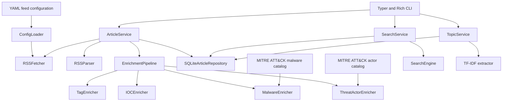

# Cybersecurity RSS Reader

A modular cybersecurity RSS and threat intelligence reader built with Python 3.12+, with a CLI, browser frontend, read-only HTTP API, and separate collector worker.

The application collects RSS/Atom feeds, normalizes articles, enriches them with cybersecurity metadata, stores them in a transactional SQLite archive, and exposes search, filtering, and topic extraction through a Typer and Rich CLI or an optional FastAPI interface.

## Status

- Version: `0.1.0`
- Python: `>=3.12`
- Interfaces: terminal CLI, browser frontend and optional read-only HTTP API
- Storage backend: SQLite by default; legacy JSON adapter available
- Current topic extractor: TF-IDF
- Feed configuration: YAML
- Threat actor and malware catalogs: MITRE ATT&CK Enterprise

## Features

### Feed collection

- RSS and Atom parsing
- Concurrent feed downloads
- Configurable HTTP timeouts, retries, and User-Agent
- YAML-based feed configuration
- Automatic category discovery
- Feed enable/disable support
- Duplicate feed name and URL validation

The repository currently ships with 53 enabled feeds across 13 categories:

- `apt`
- `detection`
- `dfir`
- `exploit`
- `government`
- `malware`
- `news`
- `osint`
- `podcasts`
- `threat_hunting`
- `threat_intelligence`
- `vendors`
- `vulnerability`

### Article processing

- Unified article model
- HTML cleanup and article normalization
- Publication date parsing
- Duplicate article handling
- SQLite archive with refresh interval and historical retention
- Forced refresh support

Each normalized article can contain:

- title
- source
- summary
- URL
- category
- author
- publication date
- tags
- indicators of compromise
- detected malware families
- detected threat actors

### Enrichment pipeline

Articles pass through an asynchronous enrichment pipeline in this order:

1. `TagEnricher`
2. `IOCEnricher`
3. `MalwareEnricher`
4. `ThreatActorEnricher`

The pipeline returns new immutable article instances and can continue processing when an individual enricher fails.

#### Tag enrichment

The tag enricher:

- normalizes tags supplied by feeds
- removes duplicate tags
- extracts common cybersecurity keywords
- extracts CVE identifiers as tags

#### IOC extraction

The IOC enricher currently supports:

- IPv4 addresses
- IPv6 addresses
- domains
- URLs
- email addresses
- MD5 hashes
- SHA-1 hashes
- SHA-256 hashes
- CVE identifiers
- autonomous system numbers

#### Malware detection

`MalwareEnricher` detects canonical malware names and known aliases in article titles, summaries, and tags. Detected names are stored in the dedicated `Article.malware` field rather than mixed with generic tags.

The malware catalog is generated from active, non-deprecated MITRE ATT&CK Enterprise STIX 2.1 `malware` objects. The matcher:

- uses token boundaries to reduce substring false positives
- deduplicates canonical names case-insensitively
- ignores generic aliases such as `malware`, `trojan`, and `ransomware`
- skips aliases assigned to more than one malware entry
- preserves malware names already present on an article
- becomes a safe no-op when the catalog is missing or invalid

#### Threat actor detection

Threat actors are detected using a normalized local catalog generated from MITRE ATT&CK Enterprise STIX 2.1 data.

The catalog supports:

- MITRE group names
- known aliases
- local alias overrides
- ambiguous-alias detection
- catalog regeneration from a specific or latest stable ATT&CK release

Ambiguous aliases assigned to more than one actor are intentionally skipped.

### Search and analysis

- keyword search
- category filtering
- source filtering
- tag filtering for latest articles
- fuzzy matching
- latest-article listing
- source and category views
- TF-IDF topic extraction
- Rich terminal tables

## Architecture

The project uses explicit dependency injection and separates CLI, application services, domain models, infrastructure, and enrichment components.



`ApplicationContainer` creates and wires the concrete implementations. The CLI receives only the application services it requires and does not access the repository, parser, or fetcher directly.

## Project structure

```text
cyber-rss-reader/
├── src/
│   ├── app/                    # Bootstrap and dependency injection
│   ├── cli/                    # Typer commands and Rich formatting
│   ├── config/
│   │   ├── feeds/              # RSS/Atom category files
│   │   ├── catalogs/           # Generated actor catalog and local overrides
│   │   ├── loader.py
│   │   ├── models.py
│   │   └── paths.py
│   ├── cti/                    # ATT&CK actor and malware catalog processing
│   ├── enrichment/             # Tag, IOC, malware, and threat actor enrichers
│   ├── feeds/                  # HTTP client and concurrent feed fetching
│   ├── parser/                 # RSS parsing and normalized article models
│   ├── search/                 # Search engine, query parsing, and filters
│   ├── services/               # Application services
│   ├── storage/                # Repository interface, SQLite and legacy JSON
│   ├── tools/                  # Catalog maintenance CLI
│   └── topics/                 # Topic extraction abstractions and algorithms
├── tests/
│   ├── cti/
│   ├── enrichment/
│   ├── integration/
│   └── unit/
├── cache/                      # Legacy JSON cache
├── data/                       # Downloaded source data, including ATT&CK STIX
├── logs/                       # Runtime logs
├── pyproject.toml              # Package metadata and dependency source of truth
├── requirements.txt            # Development bootstrap
└── README.md
```

## Installation

### Requirements

- Python 3.12 or newer
- `pip`
- Git
- internet access for feed updates and ATT&CK catalog downloads

### Clone the repository

```bash
git clone git@github.com:arieltoniatto/cyber-rss-reader.git
cd cyber-rss-reader
```

### Create a virtual environment

Linux or macOS:

```bash
python3.12 -m venv .venv
source .venv/bin/activate
```

Windows PowerShell:

```powershell
py -3.12 -m venv .venv
.venv\Scripts\Activate.ps1
```

Upgrade the packaging tools:

```bash
python -m pip install --upgrade pip
```

### Development installation

`requirements.txt` installs the project in editable mode with the `dev` dependency group:

```bash
python -m pip install -r requirements.txt
```

This is equivalent to:

```bash
python -m pip install -e '.[dev]'
```

### Runtime-only editable installation

```bash
python -m pip install -e .
```

### Validate the installation

```bash
rss --help
rss-update-actors --help
rss-update-malware --help
python -m pip check
```

The installation creates two console commands:

| Command | Purpose |
|---|---|
| `rss` | Main RSS reader CLI |
| `rss-update-actors` | Download ATT&CK STIX and rebuild the actor catalog |
| `rss-update-malware` | Build the malware catalog from a local ATT&CK STIX bundle |

## Usage

### Update feeds

Use the cache when it is still valid:

```bash
rss update
```

Ignore the cache and download every configured feed again:

```bash
rss update --refresh
```

Short form:

```bash
rss update -r
```

The default refresh interval is six hours. CLI queries read the archive without downloading feeds. `rss update --refresh` upserts the current feed entries and preserves older articles.

### Show latest articles

```bash
rss latest
```

Limit the number of results:

```bash
rss latest --limit 10
```

Filter by category:

```bash
rss latest --category threat_intelligence
```

Filter by source:

```bash
rss latest --source "Cisco Talos"
```

Filter by tag:

```bash
rss latest --tag ransomware
```

Combine filters:

```bash
rss latest \
  --category news \
  --tag vulnerability \
  --limit 10
```

Available options:

| Option | Short form | Description |
|---|---|---|
| `--category` | `-c` | Filter by category |
| `--source` | `-s` | Filter by source |
| `--tag` | `-t` | Filter by tag |
| `--limit` | `-n` | Maximum result count; default is 20 |

### Search articles

Search for a keyword:

```bash
rss search ransomware
```

Filter the search:

```bash
rss search vulnerability \
  --category government \
  --source "CISA News"
```

The CLI currently accepts `--limit`, but the search command does not yet apply it to the returned results. This is a known implementation limitation.

### Extract topics

Show the most relevant topics from cached articles:

```bash
rss topics
```

Set the result limit:

```bash
rss topics --limit 10
```

The current application container uses the TF-IDF topic extractor.

### Filter by source

```bash
rss source "BleepingComputer"
```

```bash
rss source "Microsoft Security Blog" --limit 10
```

### Filter by category

```bash
rss category threat_intelligence
```

```bash
rss category malware --limit 10
```

## Feed configuration

Feed definitions are stored in:

```text
src/config/feeds/
```

Each YAML file defines one category.

Example:

```yaml
category: news

feeds:
  - name: Example Security News
    url: https://example.com/feed.xml
    enabled: true
    description: Security news and threat reporting.
```

The category is assigned from the top-level `category` field, so a per-feed category field is not required.

### Add a feed

Add an item to an existing category file:

```yaml
- name: Example Feed
  url: https://example.com/rss.xml
  enabled: true
  description: Example cybersecurity feed.
```

No Python code changes are required.

### Disable a feed

```yaml
- name: Example Feed
  url: https://example.com/rss.xml
  enabled: false
```

Disabled feeds are excluded when the configuration is loaded.

### Add a category

Create a new YAML file under `src/config/feeds/`:

```text
src/config/feeds/cloud_security.yaml
```

```yaml
category: cloud_security

feeds:
  - name: Example Cloud Security Feed
    url: https://example.com/cloud-security.xml
    enabled: true
```

The loader automatically discovers `*.yaml` files.

### Configuration validation

The configuration layer rejects:

- invalid YAML
- fields not defined by the Pydantic models
- duplicate feed names
- duplicate feed URLs
- missing feed configuration directories

## ATT&CK intelligence catalogs

The normalized threat actor catalog is stored at:

```text
src/config/catalogs/threat_actors.json
```

The normalized malware catalog is stored at:

```text
src/config/catalogs/malware.json
```

Local overrides are stored at:

```text
src/config/catalogs/threat_actor_overrides.json
```

Downloaded ATT&CK STIX bundles are stored under:

```text
data/mitre-attack/
```

Raw STIX files are runtime artifacts and are ignored by Git. The normalized catalog is packaged with the application so threat actor detection can operate locally.

### Update to the latest stable ATT&CK version

```bash
rss-update-actors
```

### Generate from a specific ATT&CK version

```bash
rss-update-actors --version 19.1
```

### Select custom output and override paths

```bash
rss-update-actors \
  --output src/config/catalogs/threat_actors.json \
  --overrides src/config/catalogs/threat_actor_overrides.json
```

The tool downloads Enterprise ATT&CK STIX 2.1 data and rebuilds the normalized actor catalog. It also stores the raw STIX bundle under `data/mitre-attack/`.

### Build the malware catalog

Build from the latest local Enterprise ATT&CK bundle:

```bash
rss-update-malware
```

Build from an explicit bundle:

```bash
rss-update-malware \
  --input data/mitre-attack/enterprise-attack-19.1.json
```

Select a custom output path:

```bash
rss-update-malware \
  --output src/config/catalogs/malware.json
```

Run `rss-update-actors` first when no raw ATT&CK bundle exists locally. The malware updater does not perform a second network download; it normalizes `malware` objects from the selected local STIX bundle.

After generating a catalog, restart the collector and use `rss update --refresh` to enrich entries currently returned by the feeds. Archived entries no longer present in the feeds retain their previous enrichment.

## Storage and runtime data

### SQLite archive and legacy migration

The CLI, API, and worker share `data/articles.sqlite3` by default. SQLite uses
WAL and transactions, with schema version 2 recorded in `PRAGMA user_version`.
Every refresh upserts articles without deleting historical records. A failed or
empty collection does not remove existing articles. There is no automatic
retention limit; plan disk capacity or a future retention policy accordingly.

Articles are identified by URL, preserving path/query case and ignoring URL
fragments. Entries without URLs use a hash of source, title, and publication
date. Dates are normalized to UTC; legacy dates without a timezone are treated
as UTC. Deduplication happens before reporting the saved article count.

Import an existing JSON cache explicitly:

```bash
rss-import-json --input cache/articles.json --database data/articles.sqlite3
```

Import is transactional and runs once per database. The original JSON remains
untouched; import does not mark old data as freshly collected. The legacy
`JsonArticleRepository` is still available when explicitly injected or selected
with `ApplicationContainer(cache_file=...)`.

### HTTP API and collector

Install the optional web dependencies:

```bash
pip install -e '.[web]'
```

Run these commands in separate terminals, with the same data directory:

```bash
rss-api --database data/articles.sqlite3
rss-worker --database data/articles.sqlite3 --interval 21600
```

For a single collection cycle:

```bash
rss-worker --database data/articles.sqlite3 --once
```

The web interface opens at `http://127.0.0.1:8000/`; interactive API documentation is available
at `/docs`. No collection is triggered during startup or HTTP requests, and no
endpoint accepts feed URLs or modifies articles. The API needs neither the feed
configuration nor the ATT&CK catalogs. Synchronous database and analysis work
runs outside the HTTP event loop, following the
[FastAPI concurrency guidance](https://fastapi.tiangolo.com/async/).

| Endpoint | Purpose |
|---|---|
| `GET /` | Browser frontend |
| `GET /filters` | Available categories, sources and tags from the full archive |
| `GET /articles/detail?id=...` | Article details by stable ID |
| `GET /health` | Check archive access |
| `GET /feeds` | Per-feed collection status, optional `status`, `limit`, `offset` |
| `GET /articles` | Latest articles with `category`, `source`, `tag`, `limit`, `offset` |
| `GET /search?q=malware` | Fuzzy text search with `category`, `source`, `limit`, `offset` |
| `GET /topics` | TF-IDF topics with `limit` |

Article and search responses include `items`, `limit`, `offset`, and `has_more`.
Article objects include a stable `id`. Limits range from 1 to 100. Unknown
filters return an empty list. `/articles` filters and pagination run in SQLite;
search and topic extraction currently process the archive in memory.

### Browser interface

Run `rss-api` and open `http://127.0.0.1:8000/`. The frontend ships inside the
Python package and uses the same origin as the API; no Node build, CDN, external
fonts, or additional web server is required.

The responsive interface provides paginated articles, fuzzy text search,
category/source/tag filters, and article details with summary, tags, IOCs,
malware, and threat actors. Filters come from the complete archive, including
sources that no longer appear in current feed observations. Search can be
combined with an exact tag filter. Browser URLs preserve filters and pagination,
and the article dialog supports direct links, Escape, and keyboard focus.

The feed view shows errors, latest attempts/successes, successful article counts,
and collection warnings. **Atualizar tela** reloads the archive and feed state;
it does not start a collection. Run the separate worker to collect new data.
Date/time labels use the browser's local timezone. The summary shows the latest
recorded success across feeds, which does not imply every feed is up to date.

External feed text is rendered as text, not HTML. Original-article links only
accept HTTP/HTTPS. IOCs are displayed as text with a copy action rather than
clickable URLs. The interface handles loading, empty results, connection errors,
and retry. Authentication remains a future step.

Optional browser tests:

```bash
pip install -e '.[dev,browser]'
python -m playwright install chromium
pytest tests/browser
```

### Feed collection observability

`GET /feeds` returns the stored state for each observed feed, identified by its
configured URL. It includes the name and category, `status`, `last_attempt`,
`last_success`, `last_error`, `article_count`, `last_success_article_count`, and
XML parsing `warnings`. Times use UTC. Responses include pagination and a
`summary` with totals for `collecting`, `success`, and `error`. The summary is
for all observed feeds, even when the list is filtered.

Examples:

```bash
curl 'http://127.0.0.1:8000/feeds'
curl 'http://127.0.0.1:8000/feeds?status=error'
```

A cycle marks configured feeds as `collecting` before starting downloads.
Successful parsing and persistence records a new `last_success`; a failed
attempt records the error without deleting articles or replacing the previous
success timestamp/count. `article_count` is the number of unique normalized
article IDs from that feed in the latest completed attempt (zero for failures).
An empty, valid feed is a successful attempt with zero articles. Non-feed
responses, download errors, and per-feed parser errors are recorded as failures.
Malformed XML accepted by feedparser is reported through warnings.

Article updates and completed feed outcomes commit in one transaction. Cache
hits do not change attempt times. The CLI and worker report the failed feed
count. The legacy JSON adapter does not persist feed status.

Schema version 1 is upgraded automatically, preserving articles and metadata.
No historical attempts are fabricated from the old article cache; status
appears after the first collection with this version. Previously observed feeds
remain visible if configuration changes. An interrupted cycle can leave
`collecting` until the next attempt, so check timestamps when evaluating it.
There is no alert delivery or full attempt history yet.

The collector forces a refresh each cycle and waits the configured interval
**after completion**. Failed cycles are logged and retried on the next cycle;
`--once` exits with an error if the cycle raises. The worker uses a POSIX file
lock to prevent two worker processes from collecting into the same archive.
Manual `rss update` commands are not covered by that lock, but their writes
remain transactional. The worker currently targets Linux/macOS.

Set `CYBER_RSS_DATA_DIR` to an absolute directory to share runtime storage across
processes regardless of their working directories. `CYBER_RSS_FEED_DIR` and
`CYBER_RSS_CATALOG_DIR` override packaged configuration directories. Set these
variables before launching the process. Only runtime directories are created;
installed package data need not be writable. Mount the database on a local
persistent filesystem, with its WAL/SHM files; separate hosts need a server
database rather than a shared SQLite file.

For individual use on this computer, run the HTTP server at `http://127.0.0.1:8000`.
No login, certificate or LAN forwarding is needed. Continuous collection and
backups run through the user systemd units. Optional protected LAN access is
documented in [deploy/HTTPS.md](deploy/HTTPS.md).

### Continuous operation and backups

Docker Compose is also available: run `docker compose up -d --build` and open
`http://127.0.0.1:8001`. The API, collector and daily backup share a persistent
Docker volume. See [deploy/DOCKER.md](deploy/DOCKER.md) for startup, existing
archive import and switching between Docker and native services.

User systemd units for the API, worker and daily backup are supplied under
`deploy/systemd`. Render/install instructions, monitoring commands and recovery
steps are documented in [deploy/README.md](deploy/README.md).

The services use an absolute runtime directory through `.env.services`, restart
after unexpected exits, and share the existing SQLite archive. The backup timer
runs daily and retains 14 verified snapshots by default. `rss-backup` includes
committed WAL data through SQLite's online backup API; `rss-restore` verifies a
snapshot and restores only into a new destination. Automatic backups include
articles, metadata and per-feed collection state.

### Runtime directories

| Path | Purpose | Versioned |
|---|---|---|
| `data/articles.sqlite3` | SQLite archive and refresh metadata | No |
| `data/backups/` | Verified backup files and manifests | No |
| `cache/articles.json` | Legacy cache, preserved for migration | No |
| `logs/` | Runtime logs | No, except `.gitkeep` |
| `data/mitre-attack/` | Downloaded ATT&CK STIX bundles | No |
| `src/config/catalogs/malware.json` | Normalized malware catalog | Yes |
| `src/config/catalogs/threat_actors.json` | Normalized actor catalog | Yes |
| `src/config/catalogs/threat_actor_overrides.json` | Local override configuration | Yes |

## Development

### Run tests without network access

```bash
pytest -m "not integration"
```

### Run integration tests

Integration tests access external feed URLs:

```bash
pytest -m integration
```

### Run the complete test suite

```bash
pytest
```

### Validate installed dependencies

```bash
python -m pip check
```

### Build distribution artifacts

```bash
python -m build
```

Generated wheel and source distribution files are written to `dist/`.

## Dependencies

Runtime dependencies are declared in `pyproject.toml`.

| Package | Purpose |
|---|---|
| `beautifulsoup4` | HTML cleanup |
| `feedparser` | RSS and Atom parsing |
| `httpx` | HTTP client |
| `pydantic` | Feed configuration validation |
| `python-dateutil` | Date handling |
| `PyYAML` | YAML configuration loading |
| `rapidfuzz` | Fuzzy text matching |
| `rich` | Terminal tables and formatting |
| `scikit-learn` | TF-IDF topic extraction |
| `typer` | CLI framework |

Development dependencies:

| Package | Purpose |
|---|---|
| `build` | Wheel and source distribution builds |
| `pytest` | Test runner |
| `pytest-asyncio` | Asynchronous test support |

## Known limitations

- SQLite is the default backend; text search and topic extraction still load the archive into memory.
- The CLI does not currently fetch or index complete article bodies.
- Malware and threat actor enrichment perform local name and alias matching; they are not full ATT&CK technique, campaign, or relationship mapping.
- Ambiguous malware and threat actor aliases are skipped.
- Malware enrichment requires a generated `src/config/catalogs/malware.json`; an empty or missing catalog safely disables that enricher.
- The read-only API and frontend support optional authentication, LAN HTTPS and request limits; see [deploy/HTTPS.md](deploy/HTTPS.md). Multiple users/roles and authenticated write operations are not implemented.
- No server database backend or general database migration framework is implemented.

## Roadmap

Potential next stages:

- enforce and expand search result controls
- add IOC and threat actor CLI filters
- improve IOC and malware validation and false-positive handling
- add ATT&CK technique, campaign, and relationship mapping
- add CVE lookup and vulnerability enrichment
- support PostgreSQL repositories
- add configurable retention and future schema migrations
- add full-article retrieval and summarization
- provide authenticated API operations
- add structured exports and alert integrations

Roadmap items are proposals and are not part of the current `0.1.0` implementation.

## License

No license is currently declared. The repository contains an empty `LICENSE` file, which should be populated before public distribution or third-party reuse.
