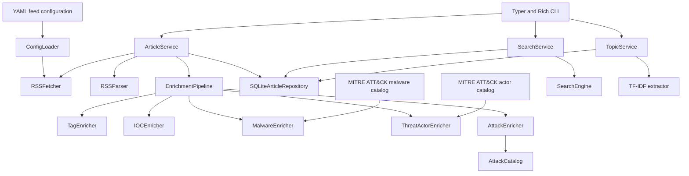

# Cybersecurity RSS Reader

A modular cybersecurity RSS and threat intelligence reader built with Python 3.12+, with a CLI, browser frontend, HTTP API with manual collection, and separate collector worker.

The application collects RSS/Atom feeds, normalizes articles, enriches them with cybersecurity metadata, stores them in a transactional SQLite or PostgreSQL archive, and exposes search, filtering, and topic extraction through a Typer and Rich CLI or an optional FastAPI interface.

## Status

- Version: `0.1.0`
- Python: `>=3.12`
- Interfaces: terminal CLI, browser frontend and optional HTTP API with manual collection
- Storage backend: SQLite by default; legacy JSON adapter available
- Current topic extractor: TF-IDF
- Feed configuration: YAML
- Threat actor and malware catalogs: MITRE ATT&CK Enterprise

## Features

### Feed collection

- RSS and Atom parsing
- Concurrent feed downloads
- Configurable HTTP timeouts, retries, and User-Agent
- YAML-based feed configuration
- Automatic category discovery
- Feed enable/disable support
- Duplicate feed name and URL validation

The repository currently ships with 53 enabled feeds across 13 categories:

- `apt`
- `detection`
- `dfir`
- `exploit`
- `government`
- `malware`
- `news`
- `osint`
- `podcasts`
- `threat_hunting`
- `threat_intelligence`
- `vendors`
- `vulnerability`

### Article processing

- Unified article model
- HTML cleanup and article normalization
- Publication date parsing
- Duplicate article handling
- SQLite or optional PostgreSQL archive with refresh interval and historical retention
- Forced refresh support

Each normalized article can contain:

- title
- source
- summary
- URL
- category
- author
- publication date
- tags
- indicators of compromise
- detected malware families
- detected threat actors

### Enrichment pipeline

Articles pass through an asynchronous enrichment pipeline in this order:

1. `TagEnricher`
2. `IOCEnricher`
3. `MalwareEnricher`
4. `ThreatActorEnricher`
5. `AttackEnricher`
6. `CVEEnricher`

The pipeline returns new immutable article instances and can continue processing when an individual enricher fails.

#### Tag enrichment

The tag enricher:

- normalizes tags supplied by feeds
- removes duplicate tags
- extracts common cybersecurity keywords
- extracts CVE identifiers as tags

Keywords match whole words with their common inflections (`exploited`,
`threat actors`, `vulnerabilities`), so `apt` no longer matches `capture` and
`malware` no longer matches `Malwarebytes`. `APT` is case-sensitive, since
lowercase "apt" is an ordinary English word. Portuguese variants produce the
same English tags (`vulnerabilidade` → `vulnerability`, `vazamento de dados` →
`data breach`, `dia zero` → `zero-day`), ignoring accents; English terms are
matched in every article, including Portuguese ones. Use `rss-retag` to apply
the current rules to articles collected before a rule change.

#### IOC extraction

The IOC enricher currently supports:

- IPv4 addresses
- IPv6 addresses
- domains
- URLs
- email addresses
- MD5 hashes
- SHA-1 hashes
- SHA-256 hashes
- CVE identifiers
- autonomous system numbers

Validation runs on both extracted IOCs and pre-existing IOCs passed through
this enricher. It checks IP syntax, DNS label/length rules, email structure,
hash length/hex characters, CVE format and the 32-bit ASN range (1–4294967295).
URLs require HTTP/HTTPS, a valid domain or IP host and a valid port. Scheme and
host are normalized while path/query case remains distinct during deduplication.
Common defanged forms (`hxxp`, `hxxps`, `[.]`, `(.)`, `[@]`) are normalized locally.
No URL is fetched or opened during enrichment.

To reduce false positives, network hosts are extracted from validated URLs;
URL paths and email local parts do not generate standalone domains/IPs.
The extractor rejects partial tokens, known file suffixes in bare-domain
candidates, and IPv4-like numbers explicitly introduced as versions/builds.
URL hosts still support domains such as `evil.zip`. IPv4 embedded in an IPv6
address does not become a separate IPv4 IOC. Private IPs are retained.
These are syntactically valid observables, not a verdict that a host is malicious
or a CVE exists; IOC extraction performs no DNS, reputation or vulnerability lookup.
CVE record lookup is a separate explicit operation described below.

#### Malware detection

`MalwareEnricher` detects canonical malware names and known aliases in article titles, summaries, and tags. Detected names are stored in the dedicated `Article.malware` field rather than mixed with generic tags.

The malware catalog is generated from active, non-deprecated MITRE ATT&CK Enterprise STIX 2.1 `malware` objects. The matcher:

- uses token boundaries and avoids joining aliases across title/summary/tag boundaries
- deduplicates canonical names case-insensitively
- ignores generic names/aliases such as `malware`, `trojan`, `ransomware`, `wiper`, `PS1` and `ZLib`
- skips aliases assigned to more than one malware entry
- preserves valid existing malware names; malformed non-string values are discarded
- ignores names found only in URLs/email addresses, including defanged URLs
- requires nearby security context for a curated list of common words and personal/place names, such as `Milan`, `Page`, `Chaos` and `Empire`
- validates catalog structure/schema and string fields, excluding revoked/deprecated entries
- becomes a safe no-op when the catalog is missing, unreadable or invalid

Common-word context is checked within 100 characters on either side, in the
same sentence and article field, for terms such as `malware`, `ransomware`,
`backdoor` or `payload`. Distinctive aliases remain detectable without this
context. This conservative heuristic can miss terse mentions of ambiguous
names; the curated list is not a complete natural-language classifier.

The updated rules apply when articles pass through enrichment, including future
collections. The archive is not bulk reprocessed. Restart the API and periodic
worker after upgrading (or rebuild/recreate the Docker services) to activate
the rules in running processes.

#### Threat actor detection

Threat actors are detected using a normalized local MITRE ATT&CK Enterprise catalog, extended with the local MISP Threat Actor Galaxy snapshot.

The catalog supports:

- MITRE group names
- known aliases
- local alias overrides
- ambiguous-alias detection
- catalog regeneration from a specific or latest stable ATT&CK release

Ambiguous aliases assigned to more than one actor are intentionally skipped.

#### MISP Threat Actor Galaxy

Actor detection combines the existing MITRE/local-override catalog with the
[MISP Threat Actor Galaxy](https://github.com/MISP/misp-galaxy/blob/main/clusters/threat-actor.json).
The original JSON is shipped locally as
`src/config/catalogs/misp_threat_actor_galaxy.json`, together with its source URL,
version, SHA-256 and download time in `misp_threat_actor_galaxy_metadata.json`.
This packaged snapshot uses the upstream [CC0 license option](https://github.com/MISP/misp-galaxy/blob/main/LICENSE.md)
and retains the Galaxy's authors and metadata.

Before each actual collection, the application checks whether the Galaxy needs
an update. **The default period is seven days (168 hours)** after the last
successful check. The worker, CLI `rss update` and manual web collection use the
same update path. With the default six-hour collector interval, a due check runs
at the next collection; there is no separate timer and no update while the
application is stopped or when a valid article cache is reused.

The runtime copy is `data/misp-galaxy/threat-actor.json`, with update status in
`data/misp-galaxy/status.json`. The first collection seeds it from the packaged
snapshot. Later checks use conditional HTTP requests (`ETag`/`Last-Modified`).
Only valid, complete Galaxy JSON replaces the local file, through an atomic
write and a shared process lock. Failures preserve the local snapshot and retry
no sooner than six hours later. If the runtime file is unavailable or corrupt,
the detector falls back to the packaged copy, then to MITRE alone if necessary.
The source uses a fixed HTTPS URL, bounded timeouts and a 10 MiB response limit;
no article data is sent to MISP/GitHub and article enrichment itself stays local.

```bash
rss-update-misp --status          # local status, without HTTP
rss-update-misp                   # update only when the period is due
rss-update-misp --force           # request an update immediately
```

Set `CYBER_RSS_MISP_UPDATE_INTERVAL_HOURS=168` to configure the period or
`CYBER_RSS_MISP_AUTO_UPDATE=0` to disable automatic HTTP checks while continuing
to use local Galaxy data. CLI `--interval-hours` overrides the period for that
invocation. A custom archive uses a `misp-galaxy` directory next to its database;
use `rss-update-misp --directory /path/to/misp-galaxy` for that archive. Docker
uses the existing runtime volume, so updates work with the read-only image and
survive restarts. These runtime files are excluded from Git and from article
backups; the packaged snapshot remains available after restoring an archive.

The detector preserves MITRE canonical names when the Galaxy has an unambiguous
identity match. Explicit group IDs/official group references take priority;
conflicting crosswalks and aliases shared by different actors are skipped.
Existing unambiguous MITRE aliases take precedence over conflicting imports.
Local MITRE alias removals are not reintroduced by the Galaxy. New single-word,
short and generic group-number aliases require nearby actor/group context;
generic actor labels and entries explicitly classified as campaigns/operations
are excluded. URL paths and hostnames do not generate actor-name matches.
MISP-only actors keep their Galaxy name; the integration does not invent MITRE
IDs, merge uncertain group profiles or infer ATT&CK relationships from MISP
`related` entries.

Long-running collectors reload the merged aliases before each collection, so
manual/weekly Galaxy updates take effect without a restart. Existing archived
actor fields are unchanged; articles returned by subsequent collections receive
the new enrichment. To activate this release, restart the services or rebuild
the Docker image; refresh the feeds to enrich current entries.

### Search and analysis

- keyword search
- category filtering
- source filtering
- tag filtering for latest articles
- fuzzy matching
- latest-article listing
- source and category views
- TF-IDF topic extraction
- Rich terminal tables

## Architecture

The project uses explicit dependency injection and separates CLI, application services, domain models, infrastructure, and enrichment components.



`ApplicationContainer` creates and wires the concrete implementations. The CLI receives only the application services it requires and does not access the repository, parser, or fetcher directly.

## Project structure

```text
cyber-rss-reader/
├── src/
│   ├── app/                    # Bootstrap and dependency injection
│   ├── cli/                    # Typer commands and Rich formatting
│   ├── config/
│   │   ├── feeds/              # RSS/Atom category files
│   │   ├── catalogs/           # Generated actor catalog and local overrides
│   │   ├── loader.py
│   │   ├── models.py
│   │   └── paths.py
│   ├── cti/                    # ATT&CK actor and malware catalog processing
│   ├── enrichment/             # Tag, IOC, malware, and threat actor enrichers
│   ├── feeds/                  # HTTP client and concurrent feed fetching
│   ├── parser/                 # RSS parsing and normalized article models
│   ├── search/                 # Search engine, query parsing, and filters
│   ├── services/               # Application services
│   ├── storage/                # Repository interface, SQLite and legacy JSON
│   ├── tools/                  # Catalog maintenance CLI
│   └── topics/                 # Topic extraction abstractions and algorithms
├── tests/
│   ├── cti/
│   ├── enrichment/
│   ├── integration/
│   └── unit/
├── cache/                      # Legacy JSON cache
├── data/                       # Downloaded source data, including ATT&CK STIX
├── logs/                       # Runtime logs
├── pyproject.toml              # Package metadata and dependency source of truth
├── requirements.txt            # Development bootstrap
└── README.md
```

## Installation

### Requirements

- Python 3.12 or newer
- `pip`
- Git
- internet access for feed updates and ATT&CK catalog downloads

### Clone the repository

```bash
git clone git@github.com:arieltoniatto/cyber-rss-reader.git
cd cyber-rss-reader
```

### Create a virtual environment

Linux or macOS:

```bash
python3.12 -m venv .venv
source .venv/bin/activate
```

Windows PowerShell:

```powershell
py -3.12 -m venv .venv
.venv\Scripts\Activate.ps1
```

Upgrade the packaging tools:

```bash
python -m pip install --upgrade pip
```

### Development installation

`requirements.txt` installs the project in editable mode with the `dev` dependency group:

```bash
python -m pip install -r requirements.txt
```

This is equivalent to:

```bash
python -m pip install -e '.[dev]'
```

### Runtime-only editable installation

```bash
python -m pip install -e .
```

### Validate the installation

```bash
rss --help
rss-update-actors --help
rss-update-malware --help
rss-update-attack --help
python -m pip check
```

The installation creates two console commands:

| Command | Purpose |
|---|---|
| `rss` | Main RSS reader CLI |
| `rss-update-actors` | Download ATT&CK STIX and rebuild the actor catalog |
| `rss-update-malware` | Build the malware catalog from a local ATT&CK STIX bundle |
| `rss-update-attack` | Build the versioned technique/campaign/relationship graph from a local STIX bundle |

## Usage

### Update feeds

Use the cache when it is still valid:

```bash
rss update
```

Ignore the cache and download every configured feed again:

```bash
rss update --refresh
```

Short form:

```bash
rss update -r
```

The default refresh interval is six hours. CLI queries read the archive without downloading feeds. `rss update --refresh` upserts the current feed entries and preserves older articles.

### Show latest articles

```bash
rss latest
```

Limit the number of results:

```bash
rss latest --limit 10
```

Filter by category:

```bash
rss latest --category threat_intelligence
```

Filter by source:

```bash
rss latest --source "Cisco Talos"
```

Filter by tag:

```bash
rss latest --tag ransomware
```

Combine filters:

```bash
rss latest \
  --category news \
  --tag vulnerability \
  --limit 10
```

Available options:

| Option | Short form | Description |
|---|---|---|
| `--category` | `-c` | Filter by category |
| `--source` | `-s` | Filter by source |
| `--tag` | `-t` | Filter by tag |
| `--limit` | `-n` | Maximum result count; default is 20 |

### Search articles

Search for a keyword:

```bash
rss search ransomware
```

Filter the search:

```bash
rss search vulnerability \
  --category government \
  --source "CISA News"
```

Search results default to the 20 newest articles. Matching and metadata/date
filters run before sorting and pagination; `--limit` must be positive and
`--offset` cannot be negative. For example:

```bash
rss search ransomware --tag research --limit 10 --offset 10 --order oldest
rss search ransomware --period week --match exact
rss search ransmware --match fuzzy --fuzzy-threshold 90
```

| Option | Values / behavior |
| --- | --- |
| `--limit`, `-n` | Positive result count, default 20 |
| `--offset` | Matching results to skip after ordering, default 0 |
| `--order` | `newest` (default) or `oldest`, by publication date |
| `--period` | `all` (default), `today` (UTC day), or `week` (last 7 days up to now) |
| `--match` | `fuzzy` (default) or `exact` |
| `--fuzzy-threshold` | Integer 0–100, default 80; higher values restrict approximate matches |
| `--tag`, `-t` | Case-insensitive tag filter, alongside category and source |

Exact matching means a case-insensitive substring of the indexed title,
summary, author, source, category or tags, not a whole-word or full-article
search. The fuzzy threshold is ignored in exact mode. Undated articles are
excluded from date-filtered searches; with the full archive they appear last
for newest ordering and first for oldest ordering.

### Filter extracted IOCs and threat actors

Both `rss search` and `rss latest` support `--ioc`, `--ioc-type` and
`--threat-actor`, together with category, source, tag and result limits:

```bash
rss latest --ioc-type cve --limit 10
rss latest --threat-actor APT28 --ioc-type ipv4
rss search ransomware --ioc CVE-2026-1234 --ioc-type cve
rss search campaign --threat-actor APT28 --tag research --limit 10
```

`--ioc` matches the complete extracted value. `--ioc-type` selects articles
containing an IOC of that type; if both are supplied, the same IOC must match
value and type. Types are `ipv4`, `ipv6`, `domain`, `url`, `email`, `md5`, `sha1`,
`sha256`, `cve`, and `asn`. IOC values are case-insensitive except URLs, which
use the stored spelling exactly, including path and query case. Whitespace
around CLI filter values is trimmed; blank values and unknown types are rejected.

`--threat-actor` matches a complete stored actor name without case sensitivity.
Aliases are not resolved at query time; use the canonical name shown in the
article's details. IOC and actor filters use the enriched metadata, not text
mentions, and remain exact even with fuzzy text search. Combined filters use
AND and apply before pagination. Unknown values return no results.

Search already loads the archive in memory; `latest` does so when IOC or actor
filters are supplied. The default SQLite `latest` path keeps SQL pagination.
These filters do not change the archive, fetch feeds or rerun enrichment.

### Extract topics

Show the most relevant topics from cached articles:

```bash
rss topics
```

Set the result limit:

```bash
rss topics --limit 10
```

The current application container uses the TF-IDF topic extractor.

### Filter by source

```bash
rss source "BleepingComputer"
```

```bash
rss source "Microsoft Security Blog" --limit 10
```

### Filter by category

```bash
rss category threat_intelligence
```

```bash
rss category malware --limit 10
```

### CVE lookup and vulnerability enrichment

`CVEEnricher` records deduplicated `Article.cve_ids` from mentioned CVEs, existing
CVE IOCs and tags. Collection remains offline for this step. Public vulnerability
records are resolved on demand from the official [CVE Services API](https://github.com/CVEProject/cve-services),
in [CVE JSON 5 format](https://github.com/CVEProject/cve-schema), without an API key.
Only the CVE ID is sent to the provider; article text is never sent.

```bash
rss cve CVE-2021-44228
rss cve CVE-2021-44228 --offline
rss cve CVE-2021-44228 --refresh
rss vulnerabilities log4j --limit 5
```

`rss cve` retrieves a missing/expired record, or reuses a fresh cache entry.
`--offline` never accesses the network; `--refresh` requests a fresh copy and
cannot be combined with `--offline`. `rss vulnerabilities` searches archived
articles and displays their mentioned CVEs and cached records without HTTP.
Older articles are supported on read without rewriting the archive.

In article details, **Vulnerabilidades CVE** shows one card per mentioned CVE.
Click **Consultar CVE** to fetch a record or **Atualizar consulta** to request a
refresh. Cards show descriptions, published/rejected state, CVSS scores and
vectors with each CNA/ADP provider, CWEs, affected products, version ranges and
conditional status changes, references, and the time of the last successful
lookup. Missing CVSS is shown as unknown. A rejected CVE does not display active
vulnerability details. A mention or affected-product range does not establish
that the article or the user's machine is affected, or that exploitation occurred.
CVE Program records may lack CVSS/product/CWE data; this feature does not add
NVD, CISA KEV or EPSS data, or classify the user's installed software.

The shared SQLite cache is `cve-cache.sqlite3` next to the article archive
(`data/cve-cache.sqlite3` by default, or next to a legacy JSON cache). Published
and rejected records expire after 24 hours; a public 404 is cached for one hour
and means **not found**, rather than proof that the identifier is invalid.
Expired records remain visible and are marked stale. Failed refreshes preserve
prior records and back off for five minutes; HTTP 429 respects a bounded
`Retry-After` delay and pauses other outbound lookups. A SQLite reservation limits
outbound calls across CLI/API processes to one every 6.1 seconds, with duplicate
in-flight requests coalesced. Reads of fresh/offline data do not consume that
budget. The client uses a fixed HTTPS provider, timeouts, a 2 MiB response limit,
validated IDs and no redirects. Feed-provided reference URLs are displayed,
not fetched. Provider/cache failures do not prevent reading articles or collecting feeds.

API operations are `GET /vulnerabilities/{cve_id}` (cache only) and
`POST /vulnerabilities/{cve_id}` with JSON `{"refresh": false}` (explicit lookup).
POST requires `X-Cyber-RSS-Request: 1`, the existing same-origin action checks,
request budgets and optional authentication. Results include `status`, `record`,
`checked_at`, `stale` and `retry_after`; provider failures/rate limits use these
status fields without presenting missing data as a clean bill of health.
`GET /articles/detail` includes `vulnerabilities` from the cache and never makes
an external request.

The cache is runtime data and is excluded from Git. Existing article backups
preserve the CVE references, but do not include this separate, rebuildable cache.
The cache is persisted by the existing Docker runtime volume; no additional
service, credentials or dependency is required. Restart API/worker processes
(or rebuild Docker images) after upgrading to register the new feature.

### ATT&CK techniques, campaigns and relationships

The packaged `src/config/catalogs/attack_mapping.json` contains the active
Enterprise ATT&CK 19.1 graph: techniques/subtechniques, campaigns, groups,
malware and tools. It is built from the existing local STIX release, with
1,748 entities and 18,721 supported relationships. Latest object revisions are
selected before revoked/deprecated objects and dangling relationships are
removed. Mapping uses the [MITRE relationship model](https://mitre-attack.github.io/attack-data-model/schemas/relationship-types/).

`AttackEnricher` runs after malware and actor enrichment. It recognizes known
ATT&CK IDs (`T1059`, `T1059.001`, `C0001`, `G0007`, `S0089`), trusted MITRE
entity URLs, unambiguous campaign names/aliases, and canonical names already
identified by the malware/actor enrichers. Technique names alone are not treated
as proof of a technique; behavioral or semantic technique classification is
not implemented. Campaign aliases shared with another campaign, group or
software entry are ignored. Unknown IDs and IDs in unrelated URL paths are ignored.

Each article stores a compact `attack` mapping with `catalog_version`,
`entity_ids`, `technique_ids` and `campaign_ids`. It does not duplicate catalog
relationships or descriptions in the archive. Existing SQLite/JSON articles
remain readable without a schema migration. Articles without saved mapping
are mapped on demand in the details API and CLI, without rewriting history.

Inspect the mapping from the CLI:

```bash
rss attack APT28 --limit 1 --max-relations 20
```

In the web interface, open an article's details and find **Mapeamento ATT&CK**.
The API adds `attack` and `attack_details` to `GET /articles/detail`.
Explicit article references use `basis: article`; related techniques/campaigns
and every relationship use `basis: catalog`. Relations retain their STIX ID,
source/target ATT&CK IDs, direction, type and catalog description.

Expansion follows `uses` edges from identified entities, software-to-technique
edges, campaign-to-group `attributed-to` edges, attributed campaigns of identified
groups, and technique-to-parent `subtechnique-of` edges. It does not reverse
infer actors from a technique or expand the entire profile of an actor merely
because a campaign was attributed to that actor. Related techniques and
campaigns are catalog context, not claims of article-specific use or attribution.

A missing/invalid catalog safely disables new mapping. Saved references remain
available. If a saved mapping uses another catalog version, detail resolution
returns `version_mismatch` and keeps the original IDs without applying new
relationships to an old snapshot. Keep the matching catalog release when
restoring an archive that needs its original contextual mapping.

Rebuild locally after obtaining a new STIX release through `rss-update-actors`:

```bash
rss-update-attack --input data/mitre-attack/enterprise-attack-19.1.json
# Equivalent without reinstalling console entry points:
python -m tools.update_attack_catalog --input data/mitre-attack/enterprise-attack-19.1.json
```

The updater accepts `--output` and `--version` (required for an unversioned
input filename), writes the catalog atomically and rejects an output equal to
the input bundle. It does not download STIX or follow references during mapping.
Reinstall the project to register the new console command. Restart API/worker
(or rebuild/recreate Docker services) after updating the catalog or application.
`CYBER_RSS_CATALOG_DIR` also selects this catalog's directory.

## Feed configuration

Feed definitions are stored in:

```text
src/config/feeds/
```

Each YAML file defines one category.

Example:

```yaml
category: news

feeds:
  - name: Example Security News
    url: https://example.com/feed.xml
    enabled: true
    description: Security news and threat reporting.
```

The category is assigned from the top-level `category` field, so a per-feed category field is not required.

### Add a feed

Add an item to an existing category file:

```yaml
- name: Example Feed
  url: https://example.com/rss.xml
  enabled: true
  description: Example cybersecurity feed.
```

No Python code changes are required.

### Feed destinations must be public

The collector only downloads feeds from public internet addresses. Every
request, including each redirect, is checked: hosts that resolve to loopback,
private (RFC 1918), link-local (such as the `169.254.169.254` cloud metadata
service), carrier-grade NAT or other non-global ranges are refused, and the
browser/API rejects such URLs when a source is saved. This prevents an edited
feed URL from reaching internal services (SSRF).

To collect from a feed hosted on your own network, set
`CYBER_RSS_ALLOW_PRIVATE_FEEDS=1` for the API and the collector. In cloud
deployments, keep this unset and also restrict egress at the network layer
(for example a Kubernetes NetworkPolicy), because a DNS answer can change
between the check and the connection.

### Disable a feed

```yaml
- name: Example Feed
  url: https://example.com/rss.xml
  enabled: false
```

Disabled feeds are excluded when the configuration is loaded.

The SANS Internet Storm Center uses `https://isc.sans.edu/rssfeed_full.xml`
for diary content. The parser excludes Stormcast announcements from the SANS
diary feeds (`rssfeed.xml` and `rssfeed_full.xml`); episodes are collected through
the separate `dailypodcast.xml` feed. This filter applies to future collections
and does not remove previously archived announcements.

### Add a category

Create a new YAML file under `src/config/feeds/`:

```text
src/config/feeds/cloud_security.yaml
```

```yaml
category: cloud_security

feeds:
  - name: Example Cloud Security Feed
    url: https://example.com/cloud-security.xml
    enabled: true
```

The loader automatically discovers `*.yaml` files.

### Configuration validation

The configuration layer rejects:

- invalid YAML
- fields not defined by the Pydantic models
- duplicate feed names
- duplicate feed URLs
- missing feed configuration directories

## ATT&CK intelligence catalogs

The normalized threat actor catalog is stored at:

```text
src/config/catalogs/threat_actors.json
```

The normalized malware catalog is stored at:

```text
src/config/catalogs/malware.json
```

Local overrides are stored at:

```text
src/config/catalogs/threat_actor_overrides.json
```

Downloaded ATT&CK STIX bundles are stored under:

```text
data/mitre-attack/
```

Raw STIX files are runtime artifacts and are ignored by Git. The normalized catalog is packaged with the application so threat actor detection can operate locally.

### Update to the latest stable ATT&CK version

```bash
rss-update-actors
```

### Generate from a specific ATT&CK version

```bash
rss-update-actors --version 19.1
```

### Select custom output and override paths

```bash
rss-update-actors \
  --output src/config/catalogs/threat_actors.json \
  --overrides src/config/catalogs/threat_actor_overrides.json
```

The tool downloads Enterprise ATT&CK STIX 2.1 data and rebuilds the normalized actor catalog. It also stores the raw STIX bundle under `data/mitre-attack/`.

### Build the malware catalog

Build from the latest local Enterprise ATT&CK bundle:

```bash
rss-update-malware
```

Build from an explicit bundle:

```bash
rss-update-malware \
  --input data/mitre-attack/enterprise-attack-19.1.json
```

Select a custom output path:

```bash
rss-update-malware \
  --output src/config/catalogs/malware.json
```

Run `rss-update-actors` first when no raw ATT&CK bundle exists locally. The malware updater does not perform a second network download; it normalizes `malware` objects from the selected local STIX bundle.

After generating a catalog, restart the collector and use `rss update --refresh` to enrich entries currently returned by the feeds. Archived entries no longer present in the feeds retain their previous enrichment.

## Storage and runtime data

### PostgreSQL repositories

Install `.[postgres]` and configure `CYBER_RSS_DATABASE_URL` or
`CYBER_RSS_DATABASE_URL_FILE` to select PostgreSQL for the CLI, API and worker.
SQLite remains the default. PostgreSQL supports transactional article/telemetry
storage, managed feeds and distributed collector locks; local CVE/MISP caches
still use the runtime directory. `rss-import-postgres` imports a SQLite archive
read-only into an empty PostgreSQL destination. PostgreSQL backups use provider
backups or `pg_dump` instead of the SQLite web snapshot controls.

See [deploy/POSTGRESQL.md](deploy/POSTGRESQL.md) for configuration, migration,
Docker secrets, backup guidance and tests. A separate `compose.postgres.yaml`
provides a PostgreSQL stack without changing the existing SQLite stack.

### SQLite archive and legacy migration

The CLI, API, and worker share `data/articles.sqlite3` by default. SQLite uses
WAL and transactions, with schema version 3 recorded in `PRAGMA user_version`.
By default, refresh upserts articles and preserves all historical records.
Optional retention can remove articles after a successful collection; a cycle
with only failed feeds does not prune the archive.

Articles are identified by URL, preserving path/query case and ignoring URL
fragments. Entries without URLs use a hash of source, title, and publication
date. Dates are normalized to UTC; legacy dates without a timezone are treated
as UTC. Deduplication happens before reporting the saved article count.

Import an existing JSON cache explicitly:

```bash
rss-import-json --input cache/articles.json --database data/articles.sqlite3
```

Import is transactional and runs once per database. The original JSON remains
untouched; import does not mark old data as freshly collected. The legacy
`JsonArticleRepository` is still available when explicitly injected or selected
with `ApplicationContainer(cache_file=...)`.

### Text supplied by RSS and Atom feeds

The parser stores the longest readable text supplied by each entry: RSS
`content:encoded` or Atom `content`, with `summary`/`description` as fallback.
Plain text, HTML and XHTML are supported; HTML is converted to text. Alternative
content representations are compared rather than concatenated. Empty,
unsupported or external-only content is ignored. No article pages or external
content URLs are fetched, and stored text is not automatically summarized or
truncated.

The web list keeps a preview of at most 600 characters and two visible lines.
Article details show all stored feed text, with scrolling for longer entries.
Search and enrichment also use this text. Existing entries receive richer text
when they appear again in a collection; archived entries absent from current
feeds keep their existing text. A feed that publishes only a short excerpt
cannot provide more text without visiting its article page.

### Structured exports and outgoing alerts

Use **Exportar página** in the web article view to download JSON, JSONL or CSV
with the current search, filters, ordering and pagination. The API offers
`GET /exports/articles?format=json&limit=1000`; the same authentication and
request limits apply. Downloads include full stored feed text and extracted
IOCs, actors, malware, ATT&CK and CVE IDs. Exporting never collects feeds.

```bash
rss export --format json --output articles.json --limit 1000
rss export --format jsonl --threat-actor APT28 --output apt28.jsonl
rss export --format csv --ioc-type cve --output vulnerabilities.csv
rss export --q ransomware --match exact --period week --order newest
```

CLI/API exports default to 1,000 records and support 1–10,000 per request with
`--offset`/`offset` for subsequent batches. The browser exports only the current
page. CLI output goes to stdout unless `--output` is set; existing files are
never overwritten. JSON has a version-1 envelope (`schema_version`,
`exported_at`, `count`, `articles`); JSONL has one article record per line.
CSV arrays/objects are JSON-encoded cells, with formula-like text neutralized
for spreadsheets. UTC dates and stable article IDs are preserved. Exports
reflect a single archive read; separate paginated requests are not a frozen
snapshot when collection is running.

Optional generic webhooks and Telegram alerts notify on newly collected
matching article IDs. Configure destinations/rules in a private JSON file
selected by `CYBER_RSS_ALERT_CONFIG`; credentials stay in environment variables.
Alerts are disabled by default. A durable transactional outbox supports retries,
leases, deduplication receipts and SQLite/PostgreSQL. Use `rss-alerts --status`
or `GET /alerts/status` to inspect it; `rss-alerts --dispatch` sends one batch,
and `rss-alerts --watch` runs an independent delivery loop. See
[alert setup, payloads and delivery semantics](deploy/alerts/README.md).

### Article retention and schema migrations

Retention is disabled by default. Configure the same values for CLI, API and
worker (in `.env.services` for user services, or `.env` for Docker Compose):

```dotenv
CYBER_RSS_RETENTION_DAYS=90
CYBER_RSS_RETENTION_MAX_ARTICLES=10000
```

Each limit accepts `0` to disable it. Age uses the last time an article was
observed during collection, **not its publication date**. Expired articles are
removed first; the size limit then keeps the most recently observed articles,
breaking ties by publication date and ID. A successful empty feed can trigger
retention; cycles with only errors cannot. Feed configuration, telemetry,
catalogs and backups are preserved. Collection and automatic pruning commit
in one transaction; the CLI/web collection result reports the removed count.
Opening the database, explicit saves and imports never trigger pruning.

Preview without modifying or upgrading the selected database:

```bash
rss-retention --days 90 --max-articles 10000
rss-retention --days 90 --max-articles 10000 --apply
```

Command overrides apply only to that invocation. `--apply` permanently removes
matching articles and records the result in `metadata.last_retention`; make a
backup first. Changing environment values requires restarting API/worker.
Defaults keep the complete history. JSON legacy adapters do not support retention.

Inspect and upgrade the configured backend (SQLite `--database` is optional):

```bash
rss-migrate --status
rss-migrate --upgrade
```

Status and retention previews open the database read-only and never initialize
it. Repository startup also applies pending migrations automatically. Before
upgrading a running installation, stop API/worker, back up, run the explicit
upgrade and restart all services, including the SQLite backup worker. An explicit
SQLite upgrade creates a validated online snapshot before changing an existing
schema and preserves existing backup copies. PostgreSQL requires a provider
backup or `pg_dump` first; no automatic PostgreSQL backup is performed.

Migrations are append-only, sequential and transactional, protected by SQLite
write locks or PostgreSQL advisory locks. A failure rolls back the full pending
chain. `schema_migrations` records version, name, checksum, time and adoption of
legacy versions. Future/unknown schemas and changed applied migrations are
rejected; downgrades are unsupported. To evolve a schema, append a migration to
`src/storage/migrations.py` and test upgrading existing versions and rollback.
Do not edit previously applied migrations. SQLite versions 1/2 upgrade to 3;
PostgreSQL version 1 upgrades to 2. Older SQLite snapshots remain restorable.

### Re-tag stored articles

Tags are extracted at collection time. After the keyword rules change, preview
and then apply them to the stored archive:

```bash
rss-retag --database data/articles.sqlite3
rss-retag --database data/articles.sqlite3 --apply
```

The preview opens the database read-only and reports how many articles change,
removed/added counts per tag and a few examples (`--examples N`). `--apply`
holds the collector lock and rewrites only tags, preserving `first_seen` and
`last_seen`, so age-based retention is unaffected. A keyword tag is removed
only when the previous substring rule explains it and the current rules do
not; keyword tags supplied by the feed itself are kept. Make a backup first.

### HTTP API and collector

Install the optional web dependencies:

```bash
pip install -e '.[web]'
```

Run these commands in separate terminals, with the same data directory:

```bash
rss-api --database data/articles.sqlite3
rss-worker --database data/articles.sqlite3 --interval 21600
```

For a single collection cycle:

```bash
rss-worker --database data/articles.sqlite3 --once
```

The web interface opens at `http://127.0.0.1:8000/`; interactive API documentation is available
at `/docs`. No collection is triggered during startup or HTTP requests, and no
endpoint accepts feed URLs or modifies articles. The API needs neither the feed
configuration nor the ATT&CK catalogs. Synchronous database and analysis work
runs outside the HTTP event loop, following the
[FastAPI concurrency guidance](https://fastapi.tiangolo.com/async/).

| Endpoint | Purpose |
|---|---|
| `GET /` | Browser frontend |
| `GET /filters` | Available categories, sources and tags from the full archive |
| `GET /articles/detail?id=...` | Article details by stable ID |
| `GET /health` | Check archive access (no authentication, for load balancer health checks; still rate limited) |
| `GET /backups` | Local snapshot list and retention |
| `GET /backups/status` | Manual backup job state |
| `POST /backups` | Generate a background snapshot with the intent header |
| `GET /backups/{backup_id}/download` | Download a verified ZIP of snapshot and manifest |
| `GET /feed-config` | Configured sources, including disabled feeds |
| `POST /feed-config` | Add a source for future collection |
| `PUT /feed-config/{feed_id}` | Edit or enable/disable a source |
| `GET /collection` | Manual collection result or active automatic cycle |
| `POST /collection` | Start background collection, with an explicit intent header |
| `GET /feeds` | Per-feed collection status, optional `status`, `limit`, `offset` |
| `GET /articles` | Latest articles with `category`, `source`, `tag`, `limit`, `offset`, `order`, `period` |
| `GET /search?q=malware` | Text search with metadata filters, pagination, `order`, `period`, `match`, `fuzzy_threshold` |
| `GET /topics` | TF-IDF topics with `limit` |

Article and search responses include `items`, `limit`, `offset`, and `has_more`.
Both endpoints validate limits of 1–100 and nonnegative offsets; `/search`
keeps its offset ceiling of 10,000. `order`, `period`, `match` and
`fuzzy_threshold` use the same values and defaults as the CLI above. Invalid
controls return HTTP 422. `/articles` supports order and period without a
text query; its default path keeps SQL pagination, while date/oldest controls
and text searches currently filter the archive in memory.
Article objects include a stable `id`. Unknown metadata filters return an empty
list. Topic extraction also currently processes the archive in memory.

### Browser interface

Run `rss-api` and open `http://127.0.0.1:8000/`. The frontend ships inside the
Python package and uses the same origin as the API; no Node build, CDN, external
fonts, or additional web server is required.

The responsive interface provides paginated articles, fuzzy text search,
category/source/tag filters, a topics view, and article details with summary, tags, IOCs,
malware, and threat actors. Filters come from the complete archive, including
sources that no longer appear in current feed observations. Search can be
combined with an exact tag filter. Browser URLs preserve filters and pagination,
and the article dialog supports direct links, Escape, and keyboard focus.

The **Gerenciar feeds** section lists configured sources, including disabled
ones. Add a source, edit its name/URL/category/description, or activate/deactivate
it without editing packaged files. HTTP/HTTPS URLs, unique names and URLs, and
category identifiers are validated. Changes are blocked during collection and
use the same intent header/authentication as manual collection. Changes take
effect on the next collection and invalidate the six-hour cache.

Before the first web edit, configuration comes from the YAML files. The first
edit saves a complete snapshot (including disabled feeds) under `managed_feeds`
in the archive's SQLite metadata. This snapshot then takes precedence over YAML
for this archive; edits to packaged YAML no longer change its managed sources.
The CLI, periodic worker and manual web collector reload this snapshot before
each update. JSON-cache mode continues to use YAML. Configuration survives API
restarts, Docker recreation, and existing SQLite backup/restore operations.
Disabling or changing a URL preserves article history and previous collection
observations; the collection-status view can still show the last error of a
source that has since been disabled. Source management does not delete history
or start a collection automatically. Restart both API and worker after upgrading.

The **Backups** section lists completed local snapshots from both scheduled and
manual backups, including creation time, article/feed counts and database size.
**Gerar backup agora** runs the existing verified SQLite snapshot routine in the
background; queries and feed collection can continue. Manual backups share the
14-snapshot retention with the default scheduled backup. There is one manual
backup job at a time; authentication, request budgets and the intent header
protect the operation. Job status resets after an API restart; snapshots persist.

**Baixar ZIP** includes the original `.sqlite3` and matching `.json` manifest.
The server validates checksums, SQLite integrity and manifest counts before
exporting. Only generated snapshot names are accepted, symlinks are rejected,
and a temporary bundle prevents retention from interrupting a download. Invalid
metadata appears in the list with downloads disabled. A damaged database is
rejected when downloading. Copy the ZIP off the server; local copies share its
disk and do not protect against losing that server.

After extracting the ZIP, use `rss-restore --backup <snapshot.sqlite3> --output
<new-file.sqlite3>` as documented in the deployment guide. Restoration remains
a CLI operation into a new archive. The web backup directory follows
`CYBER_RSS_BACKUP_DIR`, or defaults to `backups` beside the selected database.
For Docker, backups stay on the persistent archive volume and ZIPs can be saved
through the browser. Restart the API (or rebuild/recreate the Docker services)
after upgrading to enable these endpoints.

The **Tópicos** section ranks terms from the entire archive using the existing
`/topics` endpoint. Select 10, 20, 50 or 100 terms; the selection and view are
preserved in the URL (for example, `/?view=topics&topicLimit=50`). Scores express
relative relevance within the archive, not recent growth or threat severity.
Click a term to search articles with the previous category/source/tag filters
cleared. Topics load only when their section is opened and recalculate when
refreshed or after an observed collection completes. Loading, empty results,
connection failures and retry are supported. The ranking uses titles and the
text supplied by feeds, including embedded content when available. It does not fetch original article pages.

The feed view shows errors, latest attempts/successes, successful article counts,
and collection warnings. **Atualizar tela** reloads the archive and feed state;
it does not start a collection. Run the separate worker to collect new data.
**Coletar agora** starts a background collection and shows its result without
blocking archive queries. By default, **Ignorar intervalo de 6 horas** is checked
to download feeds immediately. Uncheck it to reuse a still-valid archive.
The controls detect automatic collections, prevent concurrent runs, and refresh
articles and feed status after completion. Saved counts include both inserted
and updated entries, not only new articles. Individual feed failures appear in
the result and feed view even when the overall cycle completes.

`GET /collection` reports the current manual job or an active automatic cycle.
`POST /collection` accepts `{"force_refresh": true}` and requires the
`X-Cyber-RSS-Request: 1` header. It returns 202 immediately or 409 if collection
is already running. Authentication and request budgets also apply to these
endpoints; browser cross-origin collection requests are not enabled.
Manual job results live in the API process and reset after restart; article and
feed state remain persistent. Restart both API and worker when upgrading from
the older worker that held its lock between cycles. For Docker, rebuild and
recreate the services with `docker compose up -d --build`.

Date/time labels use the browser's local timezone. The summary shows the latest
recorded success across feeds, which does not imply every feed is up to date.

External feed text is rendered as text, not HTML. Original-article links only
accept HTTP/HTTPS. IOCs are displayed as text with a copy action rather than
clickable URLs. The interface handles loading, empty results, connection errors,
and retry. Authentication remains a future step.

Optional browser tests:

```bash
pip install -e '.[dev,browser]'
python -m playwright install chromium
pytest tests/browser
```

### Feed collection observability

`GET /feeds` returns the stored state for each observed feed, identified by its
configured URL. It includes the name and category, `status`, `last_attempt`,
`last_success`, `last_error`, `article_count`, `last_success_article_count`, and
XML parsing `warnings`. Times use UTC. Responses include pagination and a
`summary` with totals for `collecting`, `success`, and `error`. The summary is
for all observed feeds, even when the list is filtered.

Examples:

```bash
curl 'http://127.0.0.1:8000/feeds'
curl 'http://127.0.0.1:8000/feeds?status=error'
```

A cycle marks configured feeds as `collecting` before starting downloads.
Successful parsing and persistence records a new `last_success`; a failed
attempt records the error without deleting articles or replacing the previous
success timestamp/count. `article_count` is the number of unique normalized
article IDs from that feed in the latest completed attempt (zero for failures).
An empty, valid feed is a successful attempt with zero articles. Non-feed
responses, download errors, and per-feed parser errors are recorded as failures.
Malformed XML accepted by feedparser is reported through warnings.

Article updates and completed feed outcomes commit in one transaction. Cache
hits do not change attempt times. The CLI and worker report the failed feed
count. The legacy JSON adapter does not persist feed status.

Schema version 1 is upgraded automatically, preserving articles and metadata.
No historical attempts are fabricated from the old article cache; status
appears after the first collection with this version. Previously observed feeds
remain visible if configuration changes. An interrupted cycle can leave
`collecting` until the next attempt, so check timestamps when evaluating it.
There is no alert delivery or full attempt history yet.

The collector forces a refresh each cycle and waits the configured interval
**after completion**. Failed cycles are logged and retried on the next cycle;
`--once` exits with an error if the cycle raises. The worker uses a POSIX file
instance lock to prevent duplicate workers and a separate collection lock
shared with manual web requests. The collection lock is released during the
six-hour wait. If a manual cycle is already running, a periodic worker skips
that attempt and retries at its next interval; `--once` reports the conflict.
Manual `rss update` commands are not covered by that lock, but their writes
remain transactional. The worker currently targets Linux/macOS.

Set `CYBER_RSS_DATA_DIR` to an absolute directory to share runtime storage across
processes regardless of their working directories. `CYBER_RSS_FEED_DIR` and
`CYBER_RSS_CATALOG_DIR` override packaged configuration directories. Set these
variables before launching the process. Only runtime directories are created;
installed package data need not be writable. Mount the database on a local
persistent filesystem, with its WAL/SHM files; separate hosts need a server
database rather than a shared SQLite file.

For individual use on this computer, run the HTTP server at `http://127.0.0.1:8000`.
No login, certificate or LAN forwarding is needed. Continuous collection and
backups run through the user systemd units. Optional protected LAN access is
documented in [deploy/HTTPS.md](deploy/HTTPS.md).

### Continuous operation and backups

Docker Compose is also available: run `docker compose up -d --build` and open
`http://127.0.0.1:8001`. The API, collector and daily backup share a persistent
Docker volume. See [deploy/DOCKER.md](deploy/DOCKER.md) for startup, existing
archive import and switching between Docker and native services.

User systemd units for the API, worker and daily backup are supplied under
`deploy/systemd`. Render/install instructions, monitoring commands and recovery
steps are documented in [deploy/README.md](deploy/README.md).

The services use an absolute runtime directory through `.env.services`, restart
after unexpected exits, and share the existing SQLite archive. The backup timer
runs daily and retains 14 verified snapshots by default. `rss-backup` includes
committed WAL data through SQLite's online backup API; `rss-restore` verifies a
snapshot and restores only into a new destination. Automatic backups include
articles, metadata and per-feed collection state.

### Runtime directories

| Path | Purpose | Versioned |
|---|---|---|
| `data/articles.sqlite3` | SQLite archive and refresh metadata | No |
| `data/cve-cache.sqlite3` | Shared CVE lookup cache and outbound budget | No |
| `data/misp-galaxy/` | Runtime MISP actor snapshot and update status | No |
| `data/backups/` | Verified backup files and manifests | No |
| `cache/articles.json` | Legacy cache, preserved for migration | No |
| `logs/` | Runtime logs | No, except `.gitkeep` |
| `data/mitre-attack/` | Downloaded ATT&CK STIX bundles | No |
| `src/config/catalogs/malware.json` | Normalized malware catalog | Yes |
| `src/config/catalogs/attack_mapping.json` | Versioned ATT&CK entity/relationship graph | Yes |
| `src/config/catalogs/misp_threat_actor_galaxy.json` | Bundled MISP actor Galaxy snapshot | Yes |
| `src/config/catalogs/misp_threat_actor_galaxy_metadata.json` | MISP snapshot provenance and timestamp | Yes |
| `src/config/catalogs/threat_actors.json` | Normalized actor catalog | Yes |
| `src/config/catalogs/threat_actor_overrides.json` | Local override configuration | Yes |

## Development

### Run tests without network access

```bash
pytest -m "not integration"
```

### Run integration tests

Integration tests access external feed URLs:

```bash
pytest -m integration
```

### Run the complete test suite

```bash
pytest
```

### Validate installed dependencies

```bash
python -m pip check
```

### Build distribution artifacts

```bash
python -m build
```

Generated wheel and source distribution files are written to `dist/`.

## Dependencies

Runtime dependencies are declared in `pyproject.toml`.

| Package | Purpose |
|---|---|
| `beautifulsoup4` | HTML cleanup |
| `feedparser` | RSS and Atom parsing |
| `httpx` | HTTP client |
| `pydantic` | Feed configuration validation |
| `python-dateutil` | Date handling |
| `PyYAML` | YAML configuration loading |
| `rapidfuzz` | Fuzzy text matching |
| `rich` | Terminal tables and formatting |
| `scikit-learn` | TF-IDF topic extraction |
| `typer` | CLI framework |

Development dependencies:

| Package | Purpose |
|---|---|
| `build` | Wheel and source distribution builds |
| `pytest` | Test runner |
| `pytest-asyncio` | Asynchronous test support |

## Known limitations

- SQLite is the default backend; text search and topic extraction still load the archive into memory.
- The CLI indexes text supplied by feeds; it does not fetch article bodies from original webpages.
- ATT&CK mapping recognizes explicit IDs/references and catalog relationships; semantic classification of article behavior into techniques is not implemented.
- Ambiguous malware and threat actor aliases are skipped.
- Malware enrichment requires a generated `src/config/catalogs/malware.json`; an empty or missing catalog safely disables that enricher.
- The API and frontend support optional authentication, LAN HTTPS and request limits; see [deploy/HTTPS.md](deploy/HTTPS.md). Multiple users/roles and general archive editing are not implemented.
- PostgreSQL supports the archive, managed feeds and collection locks. Its backups use external PostgreSQL/provider tools; schema migrations are transactional and versioned.

## Roadmap

Implemented: validated search limits and pagination, publication order,
UTC publication periods, exact/fuzzy matching and similarity controls in the
CLI, API and web interface. The web interface offers 10/20/50/100 results per
page and preserves controls in the URL, reloads and browser history. Changing
a control resets pagination; **Limpar filtros** restores all defaults.

Implemented: `--ioc`, `--ioc-type` and `--threat-actor` filters for
`rss search` and `rss latest`, using extracted article metadata.

Implemented: type-specific IOC validation and normalization, stricter token
boundaries, contextual malware matching and malformed-catalog handling.

Implemented: versioned ATT&CK technique/subtechnique, campaign and relationship
mapping, available through article details and `rss attack`.

Implemented: explicit CVE lookup, offline CVE reference enrichment, persistent
cache and vulnerability details in the CLI and web interface.

Implemented: optional PostgreSQL repositories, feed configuration and database
collector locks, with explicit SQLite import and a PostgreSQL Docker stack.

Implemented: configurable age/size retention, read-only previews and versioned,
transactional SQLite/PostgreSQL schema migrations.

Implemented: JSON/JSONL/CSV exports in the CLI/API/web interface and opt-in
generic webhook/Telegram alerts with durable delivery state.

Potential next stages:
- add full-article retrieval and summarization
- provide authenticated API operations


Roadmap items are proposals and are not part of the current `0.1.0` implementation.

## License

No license is currently declared. The repository contains an empty `LICENSE` file, which should be populated before public distribution or third-party reuse.
