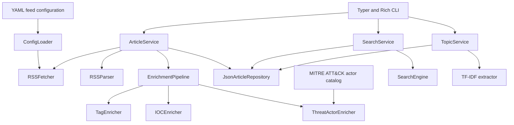

# Cybersecurity RSS Reader

A modular, terminal-based cybersecurity RSS and threat intelligence reader built with Python 3.12+.

The application collects RSS/Atom feeds, normalizes articles, enriches them with cybersecurity metadata, stores them in a local JSON cache, and exposes search, filtering, and topic extraction through a Typer and Rich CLI.

## Status

* Version: `0.1.0`
* Python: `>=3.12`
* Interface: terminal CLI
* Storage backend: local JSON
* Current topic extractor: TF-IDF
* Feed configuration: YAML
* Threat actor catalog: MITRE ATT&CK Enterprise

## Features

### Feed collection

* RSS and Atom parsing
* Concurrent feed downloads
* Configurable HTTP timeouts, retries, and User-Agent
* YAML-based feed configuration
* Automatic category discovery
* Feed enable/disable support
* Duplicate feed name and URL validation

The repository currently ships with 53 enabled feeds across 13 categories:

* `apt`
* `detection`
* `dfir`
* `exploit`
* `government`
* `malware`
* `news`
* `osint`
* `podcasts`
* `threat_hunting`
* `threat_intelligence`
* `vendors`
* `vulnerability`

### Article processing

* Unified article model
* HTML cleanup and article normalization
* Publication date parsing
* Duplicate article handling
* Local cache with expiration
* Forced refresh support

Each normalized article can contain:

* title
* source
* summary
* URL
* category
* author
* publication date
* tags
* indicators of compromise
* detected threat actors

### Enrichment pipeline

Articles pass through an asynchronous enrichment pipeline in this order:

1. `TagEnricher`
2. `IOCEnricher`
3. `ThreatActorEnricher`

The pipeline returns new immutable article instances and can continue processing when an individual enricher fails.

#### Tag enrichment

The tag enricher:

* normalizes tags supplied by feeds
* removes duplicate tags
* extracts common cybersecurity keywords
* extracts CVE identifiers as tags

#### IOC extraction

The IOC enricher currently supports:

* IPv4 addresses
* IPv6 addresses
* domains
* URLs
* email addresses
* MD5 hashes
* SHA-1 hashes
* SHA-256 hashes
* CVE identifiers
* autonomous system numbers

#### Threat actor detection

Threat actors are detected using a normalized local catalog generated from MITRE ATT&CK Enterprise STIX 2.1 data.

The catalog supports:

* MITRE group names
* known aliases
* local alias overrides
* ambiguous-alias detection
* catalog regeneration from a specific or latest stable ATT&CK release

Ambiguous aliases assigned to more than one actor are intentionally skipped.

### Search and analysis

* keyword search
* category filtering
* source filtering
* tag filtering for latest articles
* fuzzy matching
* latest-article listing
* source and category views
* TF-IDF topic extraction
* Rich terminal tables

## Architecture

The project uses explicit dependency injection and separates CLI, application services, domain models, infrastructure, and enrichment components.



`ApplicationContainer` creates and wires the concrete implementations. The CLI receives only the application services it requires and does not access the repository, parser, or fetcher directly.

## Project structure

```text
cyber-rss-reader/
├── src/
│   ├── app/                    # Bootstrap and dependency injection
│   ├── cli/                    # Typer commands and Rich formatting
│   ├── config/
│   │   ├── feeds/              # RSS/Atom category files
│   │   ├── catalogs/           # Generated actor catalog and local overrides
│   │   ├── loader.py
│   │   ├── models.py
│   │   └── paths.py
│   ├── cti/                    # ATT&CK catalog and override processing
│   ├── enrichment/             # Tag, IOC, and threat actor enrichers
│   ├── feeds/                  # HTTP client and concurrent feed fetching
│   ├── parser/                 # RSS parsing and normalized article models
│   ├── search/                 # Search engine, query parsing, and filters
│   ├── services/               # Application services
│   ├── storage/                # Repository interface and JSON backend
│   ├── tools/                  # Catalog maintenance CLI
│   └── topics/                 # Topic extraction abstractions and algorithms
├── tests/
│   ├── cti/
│   ├── enrichment/
│   ├── integration/
│   └── unit/
├── cache/                      # Generated article cache
├── data/                       # Downloaded source data, including ATT&CK STIX
├── logs/                       # Runtime logs
├── pyproject.toml              # Package metadata and dependency source of truth
├── requirements.txt            # Development bootstrap
└── README.md
```

## Installation

### Requirements

* Python 3.12 or newer
* `pip`
* Git
* internet access for feed updates and ATT&CK catalog downloads

### Clone the repository

```bash
git clone git@github.com:arieltoniatto/cyber-rss-reader.git
cd cyber-rss-reader
```

### Create a virtual environment

Linux or macOS:

```bash
python3.12 -m venv .venv
source .venv/bin/activate
```

Windows PowerShell:

```powershell
py -3.12 -m venv .venv
.venv\Scripts\Activate.ps1
```

Upgrade the packaging tools:

```bash
python -m pip install --upgrade pip
```

### Development installation

`requirements.txt` installs the project in editable mode with the `dev` dependency group:

```bash
python -m pip install -r requirements.txt
```

This is equivalent to:

```bash
python -m pip install -e '.[dev]'
```

### Runtime-only editable installation

```bash
python -m pip install -e .
```

### Validate the installation

```bash
rss --help
rss-update-actors --help
python -m pip check
```

The installation creates two console commands:

| Command             | Purpose                                            |
| ------------------- | -------------------------------------------------- |
| `rss`               | Main RSS reader CLI                                |
| `rss-update-actors` | Download ATT&CK STIX and rebuild the actor catalog |

## Usage

### Update feeds

Use the cache when it is still valid:

```bash
rss update
```

Ignore the cache and download every configured feed again:

```bash
rss update --refresh
```

Short form:

```bash
rss update -r
```

The default cache duration is six hours.

### Show latest articles

```bash
rss latest
```

Limit the number of results:

```bash
rss latest --limit 10
```

Filter by category:

```bash
rss latest --category threat_intelligence
```

Filter by source:

```bash
rss latest --source "Cisco Talos"
```

Filter by tag:

```bash
rss latest --tag ransomware
```

Combine filters:

```bash
rss latest \
  --category news \
  --tag vulnerability \
  --limit 10
```

Available options:

| Option       | Short form | Description                         |
| ------------ | ---------- | ----------------------------------- |
| `--category` | `-c`       | Filter by category                  |
| `--source`   | `-s`       | Filter by source                    |
| `--tag`      | `-t`       | Filter by tag                       |
| `--limit`    | `-n`       | Maximum result count; default is 20 |

### Search articles

Search for a keyword:

```bash
rss search ransomware
```

Filter the search:

```bash
rss search vulnerability \
  --category government \
  --source "CISA News"
```

The CLI currently accepts `--limit`, but the search command does not yet apply it to the returned results. This is a known implementation limitation.

### Extract topics

Show the most relevant topics from cached articles:

```bash
rss topics
```

Set the result limit:

```bash
rss topics --limit 10
```

The current application container uses the TF-IDF topic extractor.

### Filter by source

```bash
rss source "BleepingComputer"
```

```bash
rss source "Microsoft Security Blog" --limit 10
```

### Filter by category

```bash
rss category threat_intelligence
```

```bash
rss category malware --limit 10
```

## Feed configuration

Feed definitions are stored in:

```text
src/config/feeds/
```

Each YAML file defines one category.

Example:

```yaml
category: news

feeds:
  - name: Example Security News
    url: https://example.com/feed.xml
    enabled: true
    description: Security news and threat reporting.
```

The category is assigned from the top-level `category` field, so a per-feed category field is not required.

### Add a feed

Add an item to an existing category file:

```yaml
- name: Example Feed
  url: https://example.com/rss.xml
  enabled: true
  description: Example cybersecurity feed.
```

No Python code changes are required.

### Disable a feed

```yaml
- name: Example Feed
  url: https://example.com/rss.xml
  enabled: false
```

Disabled feeds are excluded when the configuration is loaded.

### Add a category

Create a new YAML file under `src/config/feeds/`:

```text
src/config/feeds/cloud_security.yaml
```

```yaml
category: cloud_security

feeds:
  - name: Example Cloud Security Feed
    url: https://example.com/cloud-security.xml
    enabled: true
```

The loader automatically discovers `*.yaml` files.

### Configuration validation

The configuration layer rejects:

* invalid YAML
* fields not defined by the Pydantic models
* duplicate feed names
* duplicate feed URLs
* missing feed configuration directories

## Threat actor catalog

The normalized catalog is stored at:

```text
src/config/catalogs/threat_actors.json
```

Local overrides are stored at:

```text
src/config/catalogs/threat_actor_overrides.json
```

Downloaded ATT&CK STIX bundles are stored under:

```text
data/mitre-attack/
```

Raw STIX files are runtime artifacts and are ignored by Git. The normalized catalog is packaged with the application so threat actor detection can operate locally.

### Update to the latest stable ATT&CK version

```bash
rss-update-actors
```

### Generate from a specific ATT&CK version

```bash
rss-update-actors --version 19.1
```

### Select custom output and override paths

```bash
rss-update-actors \
  --output src/config/catalogs/threat_actors.json \
  --overrides src/config/catalogs/threat_actor_overrides.json
```

The tool downloads Enterprise ATT&CK STIX 2.1 data and rebuilds the normalized actor catalog.

## Storage and runtime data

### Article cache

Articles are stored in:

```text
cache/articles.json
```

The JSON document contains:

```json
{
  "created_at": "2026-08-01T00:00:00+00:00",
  "articles": [
    {
      "title": "Example article",
      "source": "Example source",
      "summary": "Example summary",
      "url": "https://example.com/article",
      "category": "news",
      "author": null,
      "published": null,
      "tags": [],
      "iocs": [],
      "threat_actors": []
    }
  ]
}
```

The repository deduplicates articles before writing the cache.

### Runtime directories

| Path                                              | Purpose                        | Versioned             |
| ------------------------------------------------- | ------------------------------ | --------------------- |
| `cache/articles.json`                             | Article cache                  | No                    |
| `logs/`                                           | Runtime logs                   | No, except `.gitkeep` |
| `data/mitre-attack/`                              | Downloaded ATT&CK STIX bundles | No                    |
| `src/config/catalogs/threat_actors.json`          | Normalized actor catalog       | Yes                   |
| `src/config/catalogs/threat_actor_overrides.json` | Local override configuration   | Yes                   |

## Development

### Run tests without network access

```bash
pytest -m "not integration"
```

### Run integration tests

Integration tests access external feed URLs:

```bash
pytest -m integration
```

### Run the complete test suite

```bash
pytest
```

### Validate installed dependencies

```bash
python -m pip check
```

### Build distribution artifacts

```bash
python -m build
```

Generated wheel and source distribution files are written to `dist/`.

## Dependencies

Runtime dependencies are declared in `pyproject.toml`.

| Package           | Purpose                        |
| ----------------- | ------------------------------ |
| `beautifulsoup4`  | HTML cleanup                   |
| `feedparser`      | RSS and Atom parsing           |
| `httpx`           | HTTP client                    |
| `pydantic`        | Feed configuration validation  |
| `python-dateutil` | Date handling                  |
| `PyYAML`          | YAML configuration loading     |
| `rapidfuzz`       | Fuzzy text matching            |
| `rich`            | Terminal tables and formatting |
| `scikit-learn`    | TF-IDF topic extraction        |
| `typer`           | CLI framework                  |

Development dependencies:

| Package          | Purpose                              |
| ---------------- | ------------------------------------ |
| `build`          | Wheel and source distribution builds |
| `pytest`         | Test runner                          |
| `pytest-asyncio` | Asynchronous test support            |

## Known limitations

* JSON is the only implemented storage backend.
* The CLI does not currently fetch or index complete article bodies.
* Threat actor enrichment performs local name and alias matching; it is not full ATT&CK technique or campaign mapping.
* Ambiguous threat actor aliases are skipped.
* `rss search --limit` is currently accepted but not enforced.
* No REST API or web interface is implemented.
* No production database or migration system is implemented.

## Roadmap

Potential next stages:

* enforce and expand search result controls
* add IOC and threat actor CLI filters
* improve IOC validation and false-positive handling
* add ATT&CK technique, software, and relationship mapping
* add CVE lookup and vulnerability enrichment
* support SQLite and PostgreSQL repositories
* add article history and database migrations
* add full-article retrieval and summarization
* provide REST API and web interfaces
* add structured exports and alert integrations
* add containerized deployment

Roadmap items are proposals and are not part of the current `0.1.0` implementation.

## License

No license is currently declared. The repository contains an empty `LICENSE` file, which should be populated before public distribution or third-party reuse.
